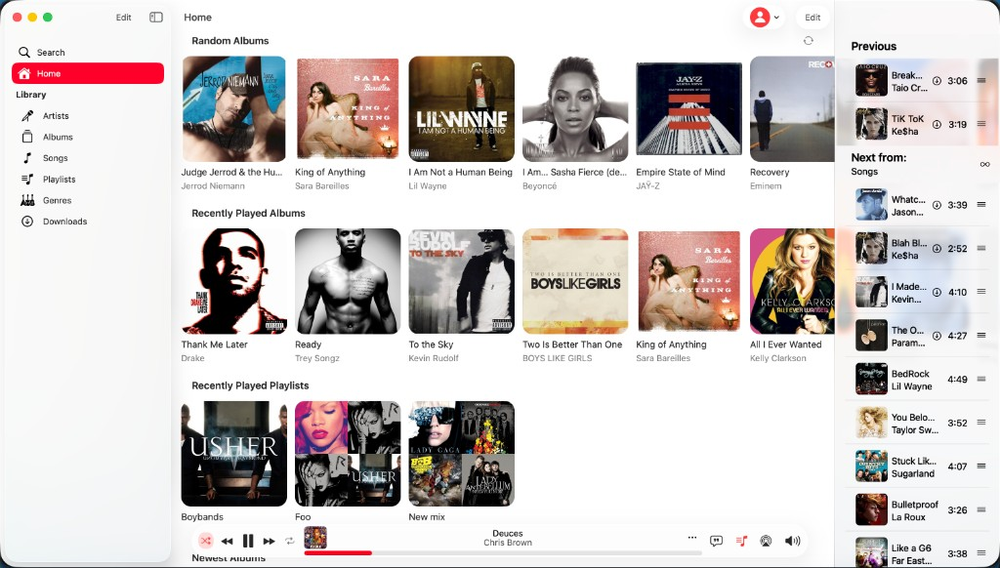

#  Amperfy+

Amperfy+ is a Mac-focused fork of [Amperfy](https://github.com/BLeeEZ/amperfy) — an iOS/iPadOS/macOS client for [Ampache](http://ampache.github.io) and [Subsonic](http://www.subsonic.org) servers.

It keeps Amperfy’s library, sync, and playback stack, with Amperfy+ branding and opinionated first-launch defaults (red theme, compact player with queue sidebar, library sidebar layout, 2&nbsp;GB cache, and related display/player preferences).



## Features

Everything from upstream Amperfy, including:

- Multi account
- Offline mode
- CarPlay
- Gapless playback for appropriate media file formats
- Music, podcast, and radio support
- Siri play media command, Siri Shortcuts, and App Intents
- Equalizer
- Replay gain
- Sleep timer
- 5-star song rating
- Favorite songs
- Scrobbling

## Requirements

* Xcode 26, Swift 6

## Getting started

1. Clone this repository:
   ```
   git clone https://github.com/jamesnos/amperfy-plus.git
   cd amperfy-plus
   ```

2. Open `Amperfy.xcodeproj` and build the **Amperfy** scheme, **or** build a local Mac Catalyst DMG:

   ```
   ./make-dmg.sh
   ```

   Output: `build/AmperfyPlus-0.2.0.dmg` (ad-hoc signed for personal use; right-click → Open on first launch if Gatekeeper prompts).

> Real device testing: Amperfy has Apple CarPlay and Siri support. To test those on a real device, a developer certificate with `com.apple.developer.playable-content` and `com.apple.developer.siri` is required. To test without CarPlay and Siri, clear the entries in `Amperfy/Amperfy.entitlements`.

## Upstream

Amperfy+ is based on [Amperfy](https://github.com/BLeeEZ/amperfy) by [BLeeEZ](https://github.com/BLeeEZ). Upstream App Store builds and beta testing live there:

- [Amperfy on the App Store](https://apps.apple.com/app/amperfy-music/id1530145038)
- [Amperfy Beta](https://github.com/BLeeEZ/amperfy/issues/25)

## Contribution

Pull requests are welcome. Please run `AmperfyKitTests` to ensure code quality. Running tests will trigger [SwiftFormat](https://github.com/nicklockwood/SwiftFormat) to apply the [Google Swift Style Guide](https://google.github.io/swift), as configured by [Google-SwiftFormat-Config](https://github.com/NoemiRozpara/Google-SwiftFormat-Config). You can also apply the style manually with `./BuildTools/applyFormat.sh`.

## Attributions

- [AudioStreaming](https://github.com/dimitris-c/AudioStreaming) by [Dimitris C.](https://github.com/dimitris-c) is licensed under [MIT License](https://github.com/dimitris-c/AudioStreaming/blob/main/LICENSE)
- [MarqueeLabel](https://github.com/cbpowell/MarqueeLabel) by [Charles Powell](https://github.com/cbpowell) is licensed under [MIT License](https://github.com/cbpowell/MarqueeLabel/blob/master/LICENSE)
- [NotificationBanner](https://github.com/Daltron/NotificationBanner) by [Dalton Hinterscher](https://github.com/Daltron) is licensed under [MIT License](https://github.com/Daltron/NotificationBanner/blob/master/LICENSE)
- [ID3TagEditor](https://github.com/chicio/ID3TagEditor) by [Fabrizio Duroni](https://github.com/chicio) is licensed under [MIT License](https://github.com/chicio/ID3TagEditor/blob/master/LICENSE.md)
- [CoreDataMigrationRevised-Example](https://github.com/wibosco/CoreDataMigrationRevised-Example) by [William Boles](https://github.com/wibosco) is licensed under [MIT License](https://github.com/wibosco/CoreDataMigrationRevised-Example/blob/master/LICENSE)
- [VYPlayIndicator](https://github.com/obrhoff/VYPlayIndicator) by [Dennis Oberhoff](https://github.com/obrhoff) is licensed under [MIT License](https://github.com/obrhoff/VYPlayIndicator/blob/master/LICENSE)
- [CallbackURLKit](https://github.com/phimage/CallbackURLKit) by [Eric Marchand](https://github.com/phimage) is licensed under [MIT License](https://github.com/phimage/CallbackURLKit/blob/master/LICENSE)
- [DominantColors](https://github.com/DenDmitriev/DominantColors) by [Den Dmitriev](https://github.com/DenDmitriev) is licensed under [MIT License](https://github.com/DenDmitriev/DominantColors/blob/main/LICENSE)
- [AudioVisualizerKit](https://github.com/Kyome22/AudioVisualizerKit) by [Takuto NAKAMURA (Kyome)](https://github.com/Kyome22) is licensed under [MIT License](https://github.com/Kyome22/AudioVisualizerKit/blob/main/LICENSE)
- [Alamofire](https://github.com/Alamofire/Alamofire) by [Alamofire](https://github.com/Alamofire) is licensed under [MIT License](https://github.com/Alamofire/Alamofire/blob/master/LICENSE)
- [Ifrit](https://github.com/ukushu/Ifrit) by [Andrii Vynnychenko](https://github.com/ukushu) is licensed under [MIT License](https://github.com/ukushu/Ifrit/blob/main/LICENSE.md)
- [swift-collections](https://github.com/apple/swift-collections) by [Apple](https://github.com/apple) is licensed under [Apache License 2.0](https://github.com/apple/swift-collections/blob/main/LICENSE.txt)
- [iOS-swiftUI-spotify-equalizer](https://github.com/urvi-k/iOS-swiftUI-spotify-equalizer) by [urvi koladiya](https://github.com/urvi-k) is licensed under [MIT License](https://github.com/urvi-k/iOS-swiftUI-spotify-equalizer/blob/main/LICENSE)

**License:** [GPLv3](LICENSE) (same as upstream Amperfy)

**Special thanks:** [Dirk Hildebrand](https://apps.apple.com/us/developer/dirk-hildebrand/id654444924) and the Amperfy maintainers
